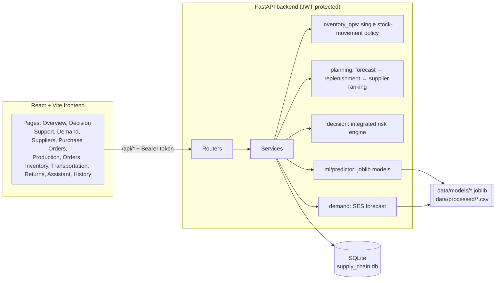
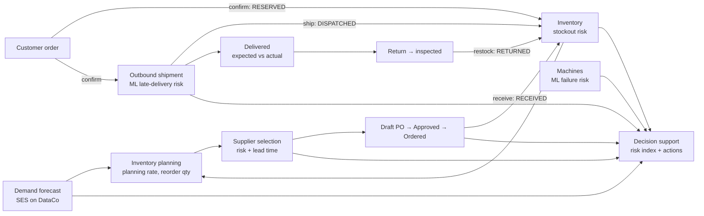
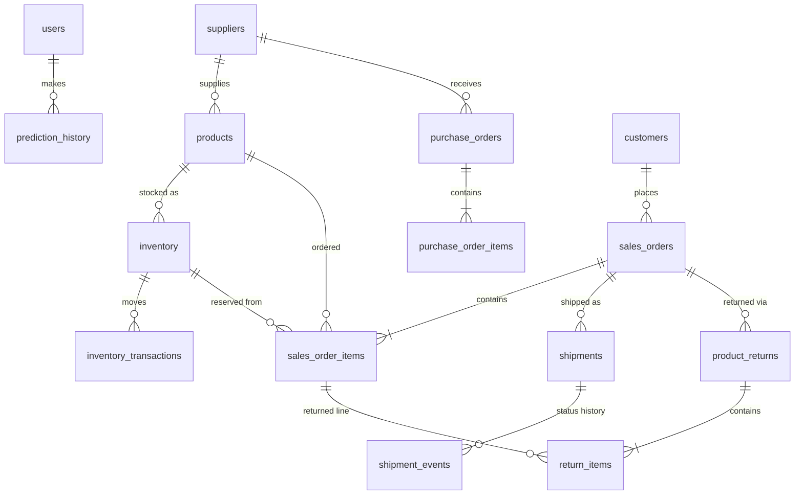

# AI Supply Chain Risk Prediction and Decision Support System Using Machine Learning

An undergraduate BSc Software Engineering / Data Science capstone project: a lightweight full-stack web application
that represents an **end-to-end supply chain** (sourcing → procurement → inbound logistics → inventory → production →
order processing → outbound delivery → returns) and connects the modules through an **integrated decision-support
engine** that combines machine-learning predictions, rule-based risk assessments and a statistical demand forecast.

| Layer | Technology |
|---|---|
| Frontend | React 19 + Vite, Tailwind CSS v4, Recharts, React Router |
| Backend | Python, FastAPI, SQLAlchemy 2, SQLite |
| Machine learning | pandas, NumPy, scikit-learn (Random Forest vs Logistic Regression), joblib |
| Authentication | JWT (PyJWT, HS256) with server-side logout (token revocation) + bcrypt password hashing |

---

## 1. Objectives

1. Predict operational risks with machine learning where real labelled data exists (machine failure, late delivery).
2. Assess risks with transparent, documented rules where no training data exists (supplier risk, stockout risk).
3. Forecast demand from real order history and use the forecast for inventory planning.
4. Implement the missing operational workflows (orders, purchase orders, stock movements, logistics tracking, returns)
   so that **a decision in one module visibly changes the others**.
5. Combine everything into one explainable risk overview with prioritised actions - every number traceable to
   database records and a documented formula, and every result labelled with the kind of evidence behind it.

---

## 2. Features

| Module | What it does | Method / evidence |
|---|---|---|
| **Authentication** | Register, sign in, logout (server-side token revocation), protected routes and APIs, duplicate-email prevention, password strength rules | bcrypt + JWT |
| **Overview (control tower)** | Totals (suppliers, products, orders, shipments), inventory alerts, high-risk suppliers / shipments, machine failure alerts, demand trend + forecast, orders by status, integrated risk overview, top priority actions | Database aggregation |
| **Decision Support** *(new)* | Overall and per-domain risk index (supplier, inventory, production, transportation, demand), ranked actions, 5 scenarios: inventory shortage, supplier risk exposure, shipment & inbound delays, equipment failure, demand vs plan | Combines all modules; documented formulas |
| **Demand Forecasting** | Monthly demand per product/category, 3-month moving average, linear trend, 3-month SES forecast with 80% range and back-test, **forecast → inventory plan** comparison | Statistical (not ML) |
| **Suppliers (Procurement)** | Supplier CRUD, CSV upload, risk score 0-100 with factor breakdown and recommendation, associated products with stock position, PO history, observed inbound on-time rate, supplier ranking per product | Rule-based |
| **Purchase Orders** *(new)* | Reorder recommendations (forecast-based quantity + recommended supplier), one-click draft PO generation, manual POs, Draft → Approved → Ordered → Received / Cancelled, receiving into stock, inbound delay tracking | Rule-based + observed |
| **Production** | Machine readings, failure probability, risk level, maintenance recommendation, single and CSV batch prediction, RF vs LR comparison | **Random Forest** (AI4I 2020) |
| **Orders** *(new)* | Customers (incl. new customer form), multi-product orders, server-side totals, availability check, Pending → Confirmed → Processing → Ready for Shipment → Shipped → Delivered / Cancelled, stock reservation/release/dispatch, ML-scored outbound shipment, preventive shipping-mode change with re-scoring, delivery recording | Workflow + ML |
| **Inventory** | Product- and warehouse-level stock, available / reserved / net / on-order, reorder level, safety stock, days of cover, stockout risk, recommended order quantity, stock adjustments, **full stock movement history**, CRUD, CSV upload | Rule-based |
| **Transportation** | Outbound tracking of order shipments (status, expected vs actual date, observed delay, predicted risk, action), inbound PO deliveries, late-delivery prediction (single / CSV), RF vs LR comparison, records filterable by source | **Random Forest** (DataCo) |
| **Returns** *(new)* | Register returns for delivered orders, Requested → Approved → Received → Inspected → Restocked / Rejected, inspection outcome, restock only when approved for restocking | Workflow |
| **AI Assistant** | Documentation answers (TF-IDF retrieval) and operational answers from **predefined, read-only database queries** (risks, priorities, reorder needs, stockouts, forecast, delayed orders, POs awaiting receipt, maintenance, returns). Not a generative LLM; no API key. | TF-IDF + fixed queries |
| **Prediction History** | Every prediction a user makes with inputs, probability, risk level and recommendation; filter, view, delete, clear | Database |

UI: white "control tower" design, sidebar grouped by supply-chain stage (Plan / Source / Make / Deliver / Return),
consistent Low / Medium / High colours (always with a text label), loading / empty / error states, confirmation
dialogs for every irreversible action, success and error notifications, and evidence tags
(**ML prediction**, **Rule-based assessment**, **Statistical forecast**, **Observed**, **Sample data**).

---

## 3. System architecture



### Integrated supply chain workflow



Examples of cross-module effects you can demonstrate:
* Confirming an order **reserves stock** → inventory net stock drops → the item may enter the reorder
  recommendations → a draft PO is generated for the best-ranked supplier → the Decision Support shortage scenario
  and the Overview cards change.
* Receiving a PO adds stock and records the actual arrival date → inbound delay and the supplier's **observed**
  on-time rate update.
* A High predicted late-delivery risk on a confirmed order appears as a priority action; changing the shipping mode
  re-scores it with the model.

### Project structure

```
supply-chain-risk-system/
├── backend/
│   ├── app/
│   │   ├── main.py              FastAPI app; on start: create tables, migrate, seed
│   │   ├── migrations.py        Additive SQLite migration (adds new columns, never drops data)
│   │   ├── demo_data.py         OPTIONAL demo scenario (python -m app.demo_data)
│   │   ├── config.py, database.py (FK enforcement), models.py, schemas.py, auth.py, seed.py
│   │   ├── routers/             auth, dashboard, decision, suppliers, purchase_orders, inventory, production,
│   │   │                        orders, customers, transportation, returns, demand, assistant, history, models_info
│   │   ├── services/            inventory_ops.py (stock policy), orders.py, purchasing.py, returns.py,
│   │   │                        planning.py, decision.py, risk.py, demand.py, assistant.py, errors.py, csv_utils.py
│   │   └── ml/                  features.py, prepare_data.py, train.py, predictor.py
│   ├── tests/                   conftest.py, test_app.py (original), test_workflows.py (new)
│   ├── requirements.txt, .env.example
├── frontend/src/
│   ├── components/              Layout (grouped sidebar), ui.jsx, feedback.jsx (confirm + toasts), charts, ...
│   ├── pages/                   Overview, DecisionSupport, Demand, Procurement, PurchaseOrders, Production,
│   │                            Orders, Inventory, Transportation, Returns, Assistant, History, Login, Register
│   └── services/                api.js, auth.jsx, useApi.js
├── data/raw | operational | processed | models
├── setup_windows.bat, start_backend.bat, start_frontend.bat, run_tests.bat, load_demo_data.bat
└── README.md
```

---

## 4. Database design



| Table | Purpose | Key constraints |
|---|---|---|
| users, revoked_tokens, prediction_history | Accounts, logged-out JWT ids, prediction log | unique email |
| suppliers, products, inventory, machines | Master / operational data (existing) | unique supplier code; product+warehouse checked unique |
| shipments | DataCo hold-out records, user predictions **and** order shipments (`source` = dataco / manual / order) + status, expected / actual delivery dates | FK to sales_orders |
| **customers** | Customer master data (DataCo market / region / segment so orders can be scored) | unique code |
| **sales_orders**, **sales_order_items** | Customer orders and lines (price, line total, stock location, line late probability) | unique (order, product); qty > 0; discount 0-1 |
| **shipment_events** | Outbound status history | FK cascade |
| **purchase_orders**, **purchase_order_items** | Replenishment orders, expected / actual arrival, received qty | unique (PO, product); qty > 0; RESTRICT delete of suppliers with POs |
| **inventory_transactions** | Every stock movement with stock after it, reference document and user | **unique idempotency key** |
| **product_returns**, **return_items** | Returns, inspection outcome, restocked qty | unique (return, order line); qty > 0 |

* SQLite foreign keys are switched on for every connection (`PRAGMA foreign_keys=ON`).
* Every workflow step runs as **one database transaction** (`services/errors.transaction`): on any error everything
  is rolled back, e.g. a multi-line order whose second line has no stock leaves the first line unreserved.
* Stock changes are **atomic conditional UPDATEs** (`available - reserved >= q`), so concurrent requests cannot
  over-reserve and quantities can never become negative.
* **Upgrading an existing database:** `create_all` adds the new tables and `app/migrations.py` adds the new
  `shipments` columns with `ALTER TABLE ... ADD COLUMN`. Users, suppliers, inventory and history are preserved; nothing
  needs to be deleted. Existing DataCo shipment rows are labelled `source = dataco` automatically.

### Inventory transaction policy

| Event | Movement | available (on hand) | reserved |
|---|---|---|---|
| PO received | RECEIVED | + q | |
| Order confirmed | RESERVED (only if net ≥ q) | | + q |
| Confirmed order cancelled | RELEASED | | − q |
| Order shipped | DISPATCHED | − q | − q |
| Return restocked | RETURNED | + q | |
| Manual adjustment / record edit | ADJUSTED (never below reserved or 0) | ± q | (edit only) |

Net stock = available − reserved. Creating an order only *checks* availability; stock is deducted at dispatch.

---

## 5. API documentation

Interactive documentation with request/response schemas: **http://127.0.0.1:8000/docs**. All routes except
register, login and health require `Authorization: Bearer <token>`.

| Area | Endpoints |
|---|---|
| Auth | `POST /api/auth/register`, `POST /api/auth/login`, `GET /api/auth/me`, `POST /api/auth/logout` |
| Dashboard | `GET /api/dashboard/summary` |
| Decision support | `GET /api/decision/report` (everything), `/overview`, `/actions`, `/inventory-shortage`, `/supplier-risk`, `/shipment-delay`, `/equipment`, `/demand-plan` |
| Suppliers | `GET/POST /api/suppliers`, `GET/PUT/DELETE /api/suppliers/{id}`, `GET /api/suppliers/recommend/{product_id}`, `GET /api/suppliers/method`, `GET /api/suppliers/template`, `POST /api/suppliers/upload` |
| Purchase orders | `GET/POST /api/purchase-orders`, `GET /api/purchase-orders/recommendations`, `POST /api/purchase-orders/generate`, `GET /api/purchase-orders/{id}`, `POST /api/purchase-orders/{id}/status`, `POST /api/purchase-orders/{id}/receive` |
| Customers | `GET/POST /api/customers`, `PUT/DELETE /api/customers/{id}` |
| Orders | `GET/POST /api/orders`, `GET /api/orders/available-products`, `GET /api/orders/{id}`, `POST /api/orders/{id}/status`, `POST /api/orders/{id}/shipping-mode` |
| Inventory | `GET /api/products`, `GET/POST /api/inventory`, `PUT/DELETE /api/inventory/{id}`, `POST /api/inventory/{id}/adjust`, `GET /api/inventory/warehouses`, `GET /api/inventory/transactions`, `GET /api/inventory/template`, `POST /api/inventory/upload` |
| Production | `GET /api/machines`, `POST /api/machines/predict`, `POST /api/machines/{id}/predict`, `DELETE /api/machines/{id}`, `GET /api/machines/template`, `POST /api/machines/upload` |
| Transportation | `GET /api/shipments` (`risk`, `source`, paging), `GET /api/shipments/outbound`, `GET /api/shipments/stats`, `GET /api/shipments/options`, `POST /api/shipments/predict`, `GET /api/shipments/template`, `POST /api/shipments/upload` |
| Returns | `GET/POST /api/returns`, `GET /api/returns/eligible-orders`, `GET /api/returns/{id}`, `POST /api/returns/{id}/status` |
| Demand | `GET /api/demand/overview`, `/products`, `/products/{id}`, `/forecast`, `/forecast/{product_id}` |
| Other | `POST /api/assistant/ask`, `GET /api/assistant/suggestions`, `GET/DELETE /api/history`, `DELETE /api/history/{id}`, `GET /api/models/metrics`, `GET /api/health` |

Errors: `401` not authenticated, `404` unknown record, `409` business-rule conflict (insufficient stock, invalid status
transition, duplicate stock movement, delete blocked), `422` invalid input (with field-level messages).

---

## 6. Datasets and data provenance

| File | Source | Status | Used for |
|---|---|---|---|
| `data/raw/ai4i2020.csv` | AI4I 2020 Predictive Maintenance Dataset (UCI) | **Real dataset** (10,000 rows) | Machine failure model; the 60 monitored machines are dataset records |
| `data/raw/DataCoSupplyChainDataset.csv` | DataCo Smart Supply Chain (Mendeley / Kaggle) | **Real dataset** (180,519 rows, ISO-8859-1) | Late-delivery model, product catalogue, demand history and forecast, daily demand rates |
| `data/operational/shipments.csv` | 800 unseen orders from the DataCo **test split** | Real historical records | Shipment records with their real outcome (`source = dataco`) |
| `data/operational/suppliers.csv` | Generated | **Simulated sample** (20 fictional suppliers) | Supplier risk |
| `data/operational/inventory.csv` | Generated | **Stock quantities simulated**, demand rates real | Inventory |
| Customers `CUS-S01…S06` | Seeded on first start | **Fictional sample** (`is_sample = true`, name starts with "Sample Customer") | Orders |
| Orders, POs, returns, movements | Created by users (or `python -m app.demo_data`, notes say "DEMO") | **User-entered / demo** | Workflows |

**Real vs simulated:** model predictions are trained on real data, but they are applied to the operational records
above. Supplier performance values, stock quantities, customers and any demo documents are *not* real-world
observations; the UI marks them as sample data. No real supplier or customer data was fabricated.

**Data preparation** (`app/ml/prepare_data.py`): duplicates removed (none found); pipelines include `SimpleImputer`
for uploaded CSVs; personal data removed from DataCo (emails, names, passwords, street, zipcode, customer IDs,
coordinates); cancelled and suspected-fraud orders excluded from demand. From **October 2017** the DataCo file contains
~80% fewer order lines, so trend analysis and forecasting use the *consistent period* Jan 2015 – Sep 2017.

---

## 7. Machine learning and analytical methods

### 7.1 Machine failure prediction - AI4I 2020 (trained ML)

* **Target:** `Machine failure` (3.39% positive). **Model used:** Random Forest (`class_weight="balanced_subsample"`);
  **baseline:** Logistic Regression (scaled, balanced). Stratified 80/20 split, `random_state=42`.
* **Inputs:** type (L/M/H), air & process temperature, rotational speed, torque, tool wear, engineered temperature
  difference and mechanical power. **Excluded:** `TWF, HDF, PWF, OSF, RNF` (target leakage), `UDI, Product ID`.

| Model (2,000-row hold-out test set) | Accuracy | Precision | Recall | F1 | ROC-AUC |
|---|---|---|---|---|---|
| **Random Forest** | 0.990 | 0.912 | 0.765 | **0.832** | **0.970** |
| Logistic Regression | 0.859 | 0.177 | 0.868 | 0.294 | 0.934 |

Risk: probability < 0.20 Low, 0.20–0.50 Medium, ≥ 0.50 High (predicted failure), plus specific maintenance checks.

### 7.2 Late-delivery prediction - DataCo (trained ML)

* **Target:** `Late_delivery_risk` (54.8% positive). Random Forest vs Logistic Regression, 80/20
  `GroupShuffleSplit` by `Order Id` (items of one order never in both sets).
* **Inputs (known at order time):** payment type, shipping mode, scheduled days, market, region, category, department,
  customer segment, quantity, price, discount, sales, order month / weekday / hour. **Excluded (leakage):** real
  shipping days, delivery status, shipping date, order status, realised profit.

| Model (35,869-row hold-out test set) | Accuracy | Precision | Recall | F1 | ROC-AUC |
|---|---|---|---|---|---|
| **Random Forest** | 0.716 | 0.852 | 0.584 | **0.693** | **0.768** |
| Logistic Regression | 0.696 | 0.846 | 0.544 | 0.662 | 0.741 |

Lower than the ~97% often quoted online because leakage columns are excluded. Risk: < 0.40 Low, 0.40–0.60 Medium,
≥ 0.60 High. **Use in orders:** every order line is scored with exactly these inputs (customer market / region /
segment, product category / department, order mode, price, quantity, discount, date); the shipment takes the
**highest** line probability. The model predicts only the probability of late delivery - not dates, carriers or
causes. Observed delays (expected vs actual date) are recorded separately and never presented as predictions.

> The metrics are read by the app from `data/models/metrics.json`, written by `python -m app.ml.train`. Retraining
> with another scikit-learn version may change them slightly.

### 7.3 Supplier risk - rule-based (not ML)

| Factor | Sub-score (capped 0-100) | Weight |
|---|---|---|
| Delivery | (100 − on-time %) × 2.5 | 30% |
| Quality | defect % × 12.5 | 25% |
| Lead-time variability | variability ÷ average lead time × 200 | 15% |
| Fulfilment | (100 − fulfilment %) × 4 | 15% |
| Financial | (5 − stability rating) ÷ 4 × 100 | 15% |

Score < 35 Low, 35–60 Medium, ≥ 60 High; the worst factor drives the recommendation.

### 7.4 Inventory stockout risk - rule-based

* Net = available − reserved; days of cover = net ÷ average daily demand.
* **High:** net ≤ safety stock or cover < lead time · **Medium:** net ≤ reorder level · **Low:** otherwise.
* Safety stock = 1.65 × σ(daily demand) × √lead time; reorder level = avg daily demand × lead time + safety stock.

### 7.5 Demand forecasting - statistical (not ML)

Simple exponential smoothing per series (`level = α·demand + (1−α)·level`), α ∈ 0.1–0.9 chosen by one-step-ahead
error; 80% range = forecast ± 1.28 × residual σ (widening with horizon); back-test on the last 3 known months vs a
3-month-average baseline (all products: MAE 302 units vs 315). Least-squares trend over 12 months: > +2% Increasing,
< −2% Decreasing. At least 8 months of history needed.

### 7.6 Inventory planning and supplier selection (`services/planning.py`) - rule-based

* Planning demand/day = max(historical avg daily demand, next-month forecast ÷ 30.4).
* Demand-plan gap = (forecast rate − historical rate) ÷ historical rate: > +20% High, > +5% Medium.
* Replenishment qty (only when stockout risk is Medium/High) = ⌈reorder level + planning rate × 30 − (net + open PO qty)⌉.
* Supplier selection score = 0.7 × (100 − supplier risk score) + 0.3 × (100 × shortest lead time ÷ supplier lead
  time), among suppliers of the product's department; High-risk suppliers ranked last; warnings when lead time
  exceeds current cover.

### 7.7 Integrated risk overview (`services/decision.py`)

* Domain index (0–100) = (High + 0.5 × Medium) ÷ items assessed × 100 for suppliers, inventory records, machines,
  transportation (active order shipments, or all shipment records if there are none) and demand-plan gaps.
* Overall index = average of available domain indices. < 20 Low, 20–40 Medium, ≥ 40 High.
* Priority actions: overdue / High-risk outbound shipments, late inbound POs or POs arriving after stock runs out,
  replenishment needs, High-risk machines, High-risk suppliers with exposure, demand-plan gaps, waiting returns.

---

## 8. Security

* Passwords hashed with **bcrypt** (cost 12, unique salt); never stored or returned in plain text; `password_hash` is
  never part of any response.
* Registration validation: valid email, 8–64 characters with a letter and a number, matching confirmation, unique
  (case-insensitive) email → HTTP 409 on duplicates.
* **JWT** (HS256, 120 min). **Every** route except register / login / health requires it, including all new
  workflow endpoints (covered by tests). Logout stores the token id (`jti`) in `revoked_tokens`.
* `SECRET_KEY` comes from `backend/.env`; if empty a random 256-bit key is generated and saved locally. Nothing is
  hardcoded.
* All input is validated server-side by Pydantic schemas and business rules (the frontend checks are for usability
  only). Totals and prices are computed on the server.
* The assistant never builds SQL from user text: it selects one of a fixed set of read-only query functions.
* CSV uploads: `.csv` only, ≤ 5 MB, ≤ 5,000 rows, every row validated.

---

## 9. Installation and running on Windows 11

**Requirements:** Python 3.11–3.13 (64-bit, "Add python.exe to PATH" ticked) and Node.js 20.19+ or 22 LTS.

### Option A: helper scripts (double-click)

1. `setup_windows.bat` – one-time setup (virtual environment, packages, model training, frontend packages; 2–5 min).
2. `start_backend.bat` – API at http://127.0.0.1:8000 (keep the window open).
3. `start_frontend.bat` – web app at http://localhost:5173 (second window).
4. Open **http://localhost:5173**, click **Create one** and register.
5. *(Optional)* stop the backend, run `load_demo_data.bat`, start the backend again → demo orders, POs and a return.
6. `run_tests.bat` – runs the automated tests.

### Option B: Command Prompt

Terminal 1 (backend):

```bash
cd C:\Projects\supply-chain-risk-system\backend
```

```bash
python -m venv .venv
```

```bash
.venv\Scripts\activate
```

```bash
pip install -r requirements.txt
```

```bash
copy .env.example .env
```

```bash
python -m app.ml.train
```

```bash
uvicorn app.main:app --reload --port 8000
```

Terminal 2 (frontend):

```bash
cd C:\Projects\supply-chain-risk-system\frontend
```

```bash
npm install
```

```bash
npm run dev
```

Optional demo scenario (backend stopped, venv active, in `backend`):

```bash
python -m app.demo_data
```

> PowerShell: activate with `.venv\Scripts\Activate.ps1` (or use Command Prompt).
> **Upgrading from the previous version:** keep your `backend\supply_chain.db`; it is migrated automatically on start.
> Reset only if you want a clean demo: stop the backend and delete `backend\supply_chain.db`.

---

## 10. Running the tests

```bash
cd C:\Projects\supply-chain-risk-system\backend
```

```bash
.venv\Scripts\activate
```

```bash
python -m pytest -q
```

57 tests on a temporary database (your data is untouched):

* `tests/test_app.py` (17, original): registration validation, duplicate email, bcrypt, login, protected routes,
  logout revocation, supplier & inventory formulas, both ML endpoints, CSV validation, CRUD, history, demand,
  forecasting, assistant.
* `tests/test_workflows.py` (40, new): authentication of all new endpoints; customers; order validation (invalid
  product, zero / negative quantity, duplicate lines, insufficient stock, invalid mode); confirm → reserve; cancel →
  release; full fulfilment with dispatch, shipping-mode re-scoring and delivery; all-or-nothing confirmation
  (rollback); stock adjustments and guards; duplicate stock movement blocked; replenishment formula; supplier ranking
  and detail; PO workflow, invalid transitions, partial receipt, double receipt blocked; inbound delay detection;
  returns (non-delivered order, excess quantity, restock vs dispose); decision-support formulas; dashboard numbers
  match records; 11 assistant operational questions; concept questions still use documentation.

---

## 11. CSV upload formats

| Page | Required columns |
|---|---|
| Suppliers | `supplier_code,name,country,category,on_time_delivery_rate,defect_rate,avg_lead_time_days,lead_time_variability_days,fulfillment_rate,financial_stability` |
| Inventory | `product_id,warehouse,available_stock,reserved_stock,reorder_level,safety_stock,lead_time_days,avg_daily_demand` |
| Production | `machine_type,air_temperature_k,process_temperature_k,rotational_speed_rpm,torque_nm,tool_wear_min` (+ optional `machine_code`) |
| Transportation | `order_date,payment_type,shipping_mode,scheduled_shipping_days,market,order_region,category_name,department_name,customer_segment,quantity,product_price,discount_rate` (+ optional `order_id,sales,product_id`) |

Inventory uploads are logged as stock movements and cannot reduce reserved stock below confirmed-order reservations.

---

## 12. Known limitations

* Supplier performance, stock quantities and customers are **sample data**; results illustrate the method, not a
  real company. Replace them via CSV upload / forms.
* DataCo is historical (2015–2018). The demand forecast continues from Sep 2017 and is used as a demand *level*; it is
  not a calendar forecast for today's date. Some products stop appearing in DataCo before Sep 2017 (product-mix
  change), so their forecast months start right after their own last recorded month.
* The late-delivery model gives a probability, not a delivery date; expected dates use DataCo's scheduled days per
  mode. It was trained on DataCo markets / categories, so customers and products must use those values.
* Machines are AI4I dataset records; there is no production schedule, capacity or bill-of-materials data, so
  equipment risk is not translated into lost output or linked to specific products.
* No purchase cost data exists: PO values are shown only when unit costs are entered. No accounting, invoicing or
  payment features (by design).
* One warehouse per order line (no split fulfilment); a PO is received once (short deliveries are recorded, not
  back-ordered).
* The assistant is retrieval + fixed queries, not a generative model; it recognises the documented question types.
* SQLite and a single-process server suit a local, single-site demo, not concurrent multi-site use.
* Status colours: Low and Medium are hard to tell apart for some colour-blind users, so every risk colour is shown
  together with its text label.

---

## 13. Troubleshooting

| Problem | Fix |
|---|---|
| `Cannot reach the server` | Start the backend (port 8000). |
| `Model file ... not found` | `python -m app.ml.train` in `backend` with the venv active. |
| `'uvicorn' is not recognized` | Activate the venv: `.venv\Scripts\activate` |
| Port in use | Close the other program, or change `--port` and the proxy in `frontend/vite.config.js`. |
| scikit-learn version warning | Retrain, then delete `backend\supply_chain.db` so seeded predictions refresh. |
| Demo data "not created" | It only runs on an empty order book (no orders yet). |
| Clean demo | Stop the backend, delete `backend\supply_chain.db`, start again (users are deleted too). |

---

## 14. Contributor

[**noman2305341091**232-35-091_B2](https://github.com/noman2305341091)
